## Mid Project Jarkom-K6

## Anggota Kelompok

| Nama                         | NRP        |
| ---------------------------- | ---------- |
| MADE GDE KRISNA WANGSA       | 5027201047 |
| Dea Chrisna Butarbutar | 5027251035 |
| Muhammad Faturrahman | 5027241065 |

# Soal 1
```
1. Perancangan topologi (10)
# Bangun topologi di Cisco Packet Tracer sesuai skema yang kalian pilih (VLSM atau
CIDR).
  o Hubungan antar-router (backbone, link L1-L6), termasuk R-ISP dan server
8.8.8.8, wajib mengikuti Gambar 1.
  o Desain setiap lokasi silakan dirancang sendiri, mencakup susunan switch,
jenis perangkat yang dipasang (PC, perangkat mobile, atau server), media
link (kabel atau wireless), serta penambahan port pada router. Tuliskan
pertimbangan dan alasannya dalam dokumentasi.
  o Cukup pasang 1 perangkat perwakilan di setiap LAN. Perhitungan subnet
tetap menggunakan jumlah host penuh.
# Ganti nama bawaan setiap perangkat (misalnya RouterO, Switch1, PC2) dengan
nama yang menunjukkan tempatnya, seperti R-PUSAT, SW-BALAIKOTA, atau
PC-CCTV-KOTA.
# Tambahkan label di setiap LAN yang berisi nama subnet, Network ID/prefix, dan jumlah host.
```

## 1. Perancangan Topologi

### Ringkasan
Topologi berbentuk **hub-and-spoke berhierarki** dengan R-PUSAT (Balai Kota) sebagai pusat, mengikuti Gambar 1 soal. Terdapat 8 router, 14 LAN, dan 6 link backbone (L1 sampai L6).

### Langkah
1. Letakkan 8 router: R-ISP, R-PUSAT, R-DC, R-BARAT, R-UTARA, R-TIMUR, R-SELATAN, R-PELABUHAN.
2. Hubungkan backbone sesuai Gambar 1: R-PUSAT ke R-ISP, L1 (R-DC), L2 (R-UTARA), L3 (R-SELATAN), L4 (R-TIMUR), L5 (R-BARAT), serta L6 (R-UTARA ke R-PELABUHAN). Server 8.8.8.8 langsung ke R-ISP.
3. Pasang satu switch per LAN dan satu perangkat wakil per LAN. Wi-Fi Publik memakai Access Point dan smartphone.
4. Tambahkan port pada router yang kekurangan port (lihat tabel).
5. Ganti nama semua perangkat sesuai lokasinya, lalu tambahkan label LAN dan label link.

### Pertimbangan desain dan alasan

| Keputusan | Alasan |
|---|---|
| Hub-and-spoke dengan R-PUSAT sebagai pusat | Sesuai Gambar 1. Kontrol terpusat, troubleshooting mudah, gangguan satu link hanya memutus satu lokasi. Kekurangannya R-PUSAT menjadi single point of failure |
| R-ISP hanya terhubung ke R-PUSAT | Semua trafik internet lewat satu gerbang, sehingga NAT dan keamanan cukup di satu titik |
| R-PELABUHAN lewat R-UTARA (L6) | Pelabuhan berada di Surabaya Utara, jadi dihubungkan ke router terdekat |
| Satu switch per LAN | Tiap LAN adalah subnet dan broadcast domain terpisah, jadi tanpa VLAN. Lebih sederhana dan sesuai Gambar 1 |
| Kabel tembaga untuk LAN sensor, server, SCADA, dan kantor | Stabil, tidak terkena interferensi, cocok untuk layanan kritis |
| Wireless hanya untuk Wi-Fi Publik | Pengguna warga memakai perangkat mobile. AP tetap dikabel ke switch agar backhaul stabil |
| Port ditambah di R-PUSAT dan R-UTARA | Router 2911 hanya punya 3 port routed bawaan, sedangkan R-PUSAT butuh 8 dan R-UTARA butuh 4 |

### Perangkat

| Jenis | Model di Packet Tracer |
|---|---|
| Router | Cisco 2911 (R-PUSAT dan R-UTARA diperluas dengan modul/port tambahan) |
| Switch | Cisco 2960-24TT |
| Access Point | Access Point-PT |
| Perangkat pengguna | PC-PT, Smartphone-PT |
| Server | Server-PT |

### Daftar LAN dan perangkat wakil

| Router | LAN | Switch | Perangkat wakil |
|---|---|---|---|
| R-PUSAT | Pegawai Balai Kota | SW-PEGAWAI-BALAIKOTA | PC-PEGAWAI-BALAIKOTA |
| R-PUSAT | Server Balai Kota | SW-SERVER-BALAIKOTA | SRV-BALAIKOTA |
| R-DC | CCTV Kota | SW-CCTV | PC-CCTV-KOTA |
| R-DC | Server dan Storage DC | SW-SERVER-DC | SRV-DC |
| R-BARAT | WiFi Publik Barat | SW-WIFI-BARAT | AP-WIFI-BARAT, HP-WIFI-BARAT |
| R-BARAT | Puskesmas dan Sekolah Barat | SW-PUSKESMAS-BARAT | PC-PUSKESMAS-BARAT |
| R-UTARA | WiFi Publik Utara | SW-WIFI-UTARA | AP-WIFI-UTARA, HP-WIFI-UTARA |
| R-UTARA | Sensor Lalu Lintas Utara | SW-SENSOR-UTARA | PC-SENSOR-LANTAS-UTARA |
| R-TIMUR | WiFi Publik Timur | SW-WIFI-TIMUR | AP-WIFI-TIMUR, HP-WIFI-TIMUR |
| R-TIMUR | Sensor Banjir Timur | SW-BANJIR-TIMUR | PC-SENSOR-BANJIR-TIMUR |
| R-SELATAN | WiFi Publik Selatan | SW-WIFI-SELATAN | AP-WIFI-SELATAN, HP-WIFI-SELATAN |
| R-SELATAN | PJU Pintar Selatan | SW-PJU-SELATAN | PC-PJU-SELATAN |
| R-PELABUHAN | Sensor dan SCADA Pelabuhan | SW-SCADA-PELABUHAN | PC-SCADA-PELABUHAN |
| R-PELABUHAN | Kantor Pelabuhan | SW-KANTOR-PELABUHAN | PC-KANTOR-PELABUHAN |
| R-ISP | Server internet | (langsung) | Server 8.8.8.8 |

### Gambar
- 
-  
- 
- 

# Soal 2
```
2. Tabel subnetting (5)
Menggunakan VLSM dan CIDR, buat tabel di spreadsheet yang berisi nama subnet, network ID, prefix, rentang host, alamat broadcast, dan gateway untuk setiap subnet sesuai dengan lembar jawaban UTS.
Kesalahan hitung di UTS boleh diperbaiki, tetapi perbaikan wajib dicatat dalam tabel revisi: subnet, jawaban di UTS, perbaikan, dan alasan kesalahannya. Perubahan yang tidak dicatat dianggap sebagai “ketidakkonsistenan”.
```

## VLSM
Berikut ini adalah perhitungan menggunakan metode VLSM.

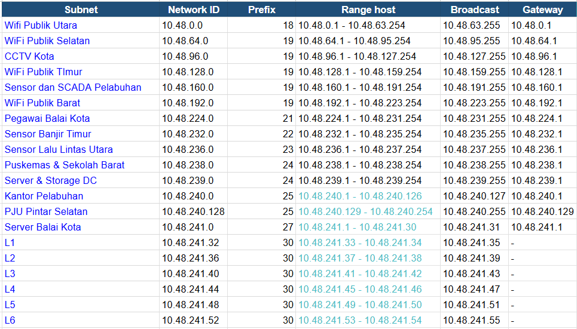

Metode VLSM dilakukan dengan mengurutkan kebutuhan host setiap subnet dari yang terbesar ke terkecil. Tiap subnet diberi prefix terpanjang yang masih mencukupi jumlah host-nya, lalu dialokasikan secara berurutan mulai dari alamat pertama blok induk. Subnet berikutnya dimulai tepat setelah alamat broadcast subnet sebelumnya, sehingga tidak ada blok yang bertumpuk dan sisa alamat yang terbuang sedikit. 

### 1. Prefix
Perhitungan prefix dilakukan dengan menghitung kebutuhan host terlebih dahulu.

Contoh perhitungan pada Wifi Publik Utara:

- Host = 11000 host
- Kebutuhan host = host + 2 -> 11000 + 2 = 11002 host
- Cari n yang -> 2ⁿ − 2 ≥ kebutuhan host
- Untuk n = 14 -> 2¹⁴ - 2 ≥ 883 (cukup)
- Prefix = 32 - n -> 32 - 14 = 18
Maka, prefix yang didapat adalah /18.

### 2. Network ID
Network ID adalah IP address awal yang mewakili subnet Wifi Publik Utara. Ini adalah subnet pertama pada blok 10.48.0.0, maka NID adalah 10.48.0.0.

### 3. Broadcast Address
Broadcast address adalah IP setelah range IP yang digunakan. Range IPnya berada pada 10.48.0.1 - 10.48.63.254, maka broadcast addressnya adalah 10.48.63.255.

### 4. Range Host
Range IP dimulai dari alamat setelah Network ID sampai dengan sebelum broadcast address, yaitu 10.48.0.1 - 10.48.63.254.

## CIDR
Berikut ini adalah perhitungan menggunakan metode VLSM.

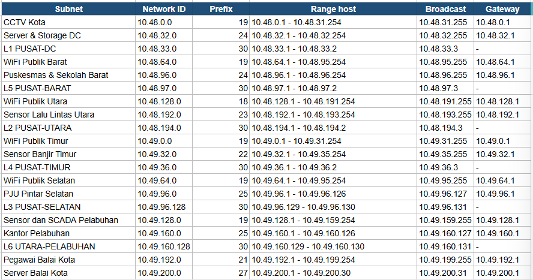
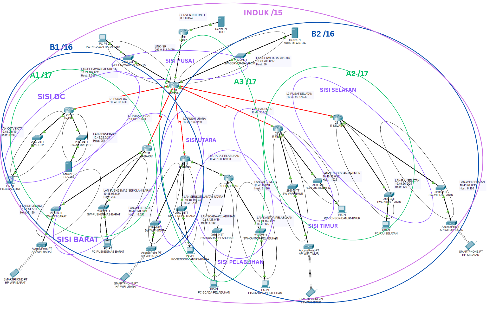
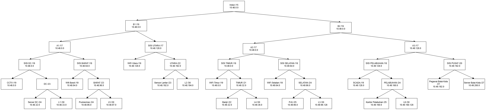

Penggabungan dilakukan pada subnet yang berdekatan dalam topologi, yaitu LAN dengan link router-nya. Jika kedua subnet memiliki prefix yang sama, keduanya digabung menjadi satu blok dengan prefix yang lebih pendek satu bit. Jika prefix-nya berbeda, diambil blok yang lebih besar, lalu prefix-nya diperpendek satu bit. Proses ini diulang hingga seluruh subnet menyatu menjadi satu blok induk.

# Soal 3
```
3. Static routing (15)
Seluruh LAN dapat saling berkomunikasi hanya dengan static route (dan default route untuk arah keluar).
Default route hanya boleh mengarah ke router di atasnya / keluar. Misalnya, default route R-DC ke R-PUSAT, R-PELABUHAN ke R-UTARA, dan R-PUSAT ke R-ISP.
R-PUSAT dan R-UTARA wajib memiliki static route ke jaringan di bawahnya (ke dalam):
R-PUSAT: ke semua LAN milik R-DC, R-UTARA, R-PELABUHAN, R-SELATAN, R-TIMUR, dan R-BARAT.
R-UTARA: ke semua LAN milik R-PELABUHAN.
```
Mengonfigurasi static route dan default route pada seluruh router sehingga semua LAN dapat saling berkomunikasi tanpa routing dinamis.

R-PUSAT (Balai Kota) menjadi pusat yang terhubung langsung ke R-ISP dan lima router cabang. R-PELABUHAN tidak terhubung langsung ke R-PUSAT, melainkan melalui R-UTARA, sehingga R-UTARA menjadi router perantara.

## Tabel Link Antar Router

| Link | Router A | Interface A | IP A | Router B | Interface B | IP B | Network |
|---|---|---|---|---|---|---|---|
| L1 | R-PUSAT | Se0/3/0 | 10.48.33.1 | R-DC | Se0/3/0 | 10.48.33.2 | 10.48.33.0/30 |
| L2 | R-PUSAT | Se0/3/1 | 10.48.97.1 | R-BARAT | Se0/3/0 | 10.48.97.2 | 10.48.97.0/30 |
| L3 | R-PUSAT | Se0/2/1 | 10.49.36.1 | R-TIMUR | Se0/3/0 | 10.49.36.2 | 10.49.36.0/30 |
| L4 | R-PUSAT | Se0/1/0 | 10.49.96.129 | R-SELATAN | Se0/3/0 | 10.49.96.130 | 10.49.96.128/30 |
| L5 | R-PUSAT | Se0/2/0 | 10.48.194.1 | R-UTARA | Se0/3/0 | 10.48.194.2 | 10.48.194.0/30 |
| L6 | R-UTARA | Gi0/2 | 10.49.160.129 | R-PELABUHAN | Gi0/0 | 10.49.160.130 | 10.49.160.128/30 |
| ISP | R-PUSAT | Gi0/0 | 203.0.113.25 | R-ISP | Gi0/1 | 203.0.113.26 | 203.0.113.24/30 |

## Tabel LAN per Router

| Router | Interface | LAN | Network | Gateway |
|---|---|---|---|---|
| R-PUSAT | Gi0/1 | Pegawai Balai Kota | 10.49.192.0/21 | 10.49.192.1 |
| R-PUSAT | Gi0/2 | Server Balai Kota | 10.49.200.0/27 | 10.49.200.1 |
| R-DC | Gi0/1 | CCTV Kota | 10.48.0.0/19 | 10.48.0.1 |
| R-DC | Gi0/2 | Server & Storage DC | 10.48.32.0/24 | 10.48.32.1 |
| R-BARAT | Gi0/1 | WiFi Publik Barat | 10.48.64.0/19 | 10.48.64.1 |
| R-BARAT | Gi0/2 | Puskesmas & Sekolah Barat | 10.48.96.0/24 | 10.48.96.1 |
| R-UTARA | Gi0/0 | WiFi Publik Utara | 10.48.128.0/18 | 10.48.128.1 |
| R-UTARA | Gi0/1 | Sensor Lalu Lintas Utara | 10.48.192.0/23 | 10.48.192.1 |
| R-TIMUR | Gi0/1 | WiFi Publik Timur | 10.49.0.0/19 | 10.49.0.1 |
| R-TIMUR | Gi0/2 | Sensor Banjir Timur | 10.49.32.0/22 | 10.49.32.1 |
| R-SELATAN | Gi0/2 | WiFi Publik Selatan | 10.49.64.0/19 | 10.49.64.1 |
| R-SELATAN | Gi0/1 | PJU Pintar Selatan | 10.49.96.0/25 | 10.49.96.1 |
| R-PELABUHAN | Gi0/1 | Sensor & SCADA Pelabuhan | 10.49.128.0/19 | 10.49.128.1 |
| R-PELABUHAN | Gi0/2 | Kantor Pelabuhan | 10.49.160.0/25 | 10.49.160.1 |

### STATIC ROUTE

Router cabang cukup memakai default route ke router di atasnya karena seluruh tujuan lain berada di balik R-PUSAT. R-PUSAT dan R-UTARA, sebagai router yang memiliki jaringan di bawahnya, memerlukan static route ke setiap LAN tersebut.

| Router | Tujuan | Next Hop | Keterangan |
|---|---|---|---|
| R-PUSAT | 0.0.0.0/0 | 203.0.113.26 | Default ke R-ISP |
| R-PUSAT | 10.48.0.0/19 | 10.48.33.2 | LAN R-DC |
| R-PUSAT | 10.48.32.0/24 | 10.48.33.2 | LAN R-DC |
| R-PUSAT | 10.48.64.0/19 | 10.48.97.2 | LAN R-BARAT |
| R-PUSAT | 10.48.96.0/24 | 10.48.97.2 | LAN R-BARAT |
| R-PUSAT | 10.49.0.0/19 | 10.49.36.2 | LAN R-TIMUR |
| R-PUSAT | 10.49.32.0/22 | 10.49.36.2 | LAN R-TIMUR |
| R-PUSAT | 10.49.64.0/19 | 10.49.96.130 | LAN R-SELATAN |
| R-PUSAT | 10.49.96.0/25 | 10.49.96.130 | LAN R-SELATAN |
| R-PUSAT | 10.48.128.0/18 | 10.48.194.2 | LAN R-UTARA |
| R-PUSAT | 10.48.192.0/23 | 10.48.194.2 | LAN R-UTARA |
| R-PUSAT | 10.49.128.0/19 | 10.48.194.2 | LAN R-PELABUHAN (via R-UTARA) |
| R-PUSAT | 10.49.160.0/25 | 10.48.194.2 | LAN R-PELABUHAN (via R-UTARA) |
| R-PUSAT | 10.49.160.128/30 | 10.48.194.2 | Link L6, agar endpoint tunnel GRE terjangkau |
| R-UTARA | 0.0.0.0/0 | 10.48.194.1 | Default ke R-PUSAT |
| R-UTARA | 10.49.128.0/19 | 10.49.160.130 | LAN R-PELABUHAN |
| R-UTARA | 10.49.160.0/25 | 10.49.160.130 | LAN R-PELABUHAN |
| R-DC | 0.0.0.0/0 | 10.48.33.1 | Default ke R-PUSAT |
| R-BARAT | 0.0.0.0/0 | 10.48.97.1 | Default ke R-PUSAT |
| R-TIMUR | 0.0.0.0/0 | 10.49.36.1 | Default ke R-PUSAT |
| R-SELATAN | 0.0.0.0/0 | 10.49.96.129 | Default ke R-PUSAT |
| R-PELABUHAN | 0.0.0.0/0 | 10.49.160.129 | Default ke R-UTARA |

# Soal 4
```
4. DHCP (10)
. Interface router dan seluruh server menggunakan IP statis.
. Perangkat pengguna mendapat IP dinamis secara otomatis, lengkap dengan
gateway dan DNS server (soal 8), tanpa bentrok dengan alamat IP statis.
. Khusus untuk subnet CCTV Kota (subnet R-DC) mendapatkan alamat dari server
DHCP di LAN Server dan Storage DC, bukan dari router.
```

## 4. DHCP

### Ringkasan
- Interface router dan semua server memakai **IP statis**.
- PC dan smartphone memakai **IP dinamis** lengkap dengan gateway dan DNS (`10.48.32.2`).
- Subnet CCTV Kota dilayani **DHCP di SRV-DC**, dengan relay `ip helper-address` di R-DC.
- Alamat awal tiap LAN (`.1` sampai `.10`) dikecualikan agar tidak bentrok dengan IP statis.

### Langkah
1. Isi IP statis server (lihat bagian 2).
2. **DHCP CCTV di SRV-DC:** Services, DHCP, On, dengan pool:

| Kolom | Isi |
|---|---|
| Pool Name | CCTV-KOTA |
| Default Gateway | 10.48.0.1 |
| DNS Server | 10.48.32.2 |
| Start IP | 10.48.0.10 |
| Subnet Mask | 255.255.224.0 |

3. **Relay di R-DC** (interface ke SW-CCTV, Gi0/1):
```
interface GigabitEthernet0/1
 ip helper-address 10.48.32.2
```
4. **DHCP di router** untuk 11 LAN pengguna (LAN CCTV dilayani SRV-DC, LAN server memakai IP statis sehingga tidak dibuatkan pool). Konfigurasi per router:

**R-PUSAT**
```
ip dhcp excluded-address 10.49.192.1 10.49.192.10
ip dhcp pool PEGAWAI-BALAIKOTA
 network 10.49.192.0 255.255.248.0
 default-router 10.49.192.1
 dns-server 10.48.32.2
```
 
**R-BARAT**
```
ip dhcp excluded-address 10.48.64.1 10.48.64.10
ip dhcp excluded-address 10.48.96.1 10.48.96.10
ip dhcp pool WIFI-BARAT
 network 10.48.64.0 255.255.224.0
 default-router 10.48.64.1
 dns-server 10.48.32.2
ip dhcp pool PUSKESMAS-BARAT
 network 10.48.96.0 255.255.255.0
 default-router 10.48.96.1
 dns-server 10.48.32.2
```
 
**R-UTARA**
```
ip dhcp excluded-address 10.48.128.1 10.48.128.10
ip dhcp excluded-address 10.48.192.1 10.48.192.10
ip dhcp pool WIFI-UTARA
 network 10.48.128.0 255.255.192.0
 default-router 10.48.128.1
 dns-server 10.48.32.2
ip dhcp pool SENSOR-LANTAS-UTARA
 network 10.48.192.0 255.255.254.0
 default-router 10.48.192.1
 dns-server 10.48.32.2
```
 
**R-TIMUR**
```
ip dhcp excluded-address 10.49.0.1 10.49.0.10
ip dhcp excluded-address 10.49.32.1 10.49.32.10
ip dhcp pool WIFI-TIMUR
 network 10.49.0.0 255.255.224.0
 default-router 10.49.0.1
 dns-server 10.48.32.2
ip dhcp pool SENSOR-BANJIR-TIMUR
 network 10.49.32.0 255.255.252.0
 default-router 10.49.32.1
 dns-server 10.48.32.2
```
 
**R-SELATAN**
```
ip dhcp excluded-address 10.49.64.1 10.49.64.10
ip dhcp excluded-address 10.49.96.1 10.49.96.10
ip dhcp pool WIFI-SELATAN
 network 10.49.64.0 255.255.224.0
 default-router 10.49.64.1
 dns-server 10.48.32.2
ip dhcp pool PJU-SELATAN
 network 10.49.96.0 255.255.255.128
 default-router 10.49.96.1
 dns-server 10.48.32.2
```
 
**R-PELABUHAN**
```
ip dhcp excluded-address 10.49.128.1 10.49.128.10
ip dhcp excluded-address 10.49.160.1 10.49.160.10
ip dhcp pool SCADA-PELABUHAN
 network 10.49.128.0 255.255.224.0
 default-router 10.49.128.1
 dns-server 10.48.32.2
ip dhcp pool KANTOR-PELABUHAN
 network 10.49.160.0 255.255.255.128
 default-router 10.49.160.1
 dns-server 10.48.32.2
```
 
**Ringkasan pool (dari tabel subnet UTS)**
 
| Router | Pool | Network ID | Mask (prefix) | Gateway |
|---|---|---|---|---|
| R-PUSAT | PEGAWAI-BALAIKOTA | 10.49.192.0 | 255.255.248.0 (/21) | 10.49.192.1 |
| R-BARAT | WIFI-BARAT | 10.48.64.0 | 255.255.224.0 (/19) | 10.48.64.1 |
| R-BARAT | PUSKESMAS-BARAT | 10.48.96.0 | 255.255.255.0 (/24) | 10.48.96.1 |
| R-UTARA | WIFI-UTARA | 10.48.128.0 | 255.255.192.0 (/18) | 10.48.128.1 |
| R-UTARA | SENSOR-LANTAS-UTARA | 10.48.192.0 | 255.255.254.0 (/23) | 10.48.192.1 |
| R-TIMUR | WIFI-TIMUR | 10.49.0.0 | 255.255.224.0 (/19) | 10.49.0.1 |
| R-TIMUR | SENSOR-BANJIR-TIMUR | 10.49.32.0 | 255.255.252.0 (/22) | 10.49.32.1 |
| R-SELATAN | WIFI-SELATAN | 10.49.64.0 | 255.255.224.0 (/19) | 10.49.64.1 |
| R-SELATAN | PJU-SELATAN | 10.49.96.0 | 255.255.255.128 (/25) | 10.49.96.1 |
| R-PELABUHAN | SCADA-PELABUHAN | 10.49.128.0 | 255.255.224.0 (/19) | 10.49.128.1 |
| R-PELABUHAN | KANTOR-PELABUHAN | 10.49.160.0 | 255.255.255.128 (/25) | 10.49.160.1 |
 
5. Ubah semua PC dan smartphone ke **DHCP**.

### Asal angka di konfigurasi
- `network` adalah Network ID, mask berasal dari prefix, dan `default-router` adalah Gateway dari tabel UTS.
- `excluded-address .1 sampai .10`: `.1` dipakai gateway, `.2` sampai `.10` cadangan alamat statis.

### Alasan
DHCP CCTV dipusatkan di server sesuai syarat soal, dan relay dipakai karena broadcast DHCP tidak melewati router. LAN lain memakai DHCP router karena sederhana dan tidak bergantung pada server lain.

### Pengujian
- `ipconfig` di PC: IP, mask, gateway, dan DNS sesuai LAN-nya.
- `show ip dhcp binding` di router, dan tab DHCP di SRV-DC untuk lease CCTV.

### Gambar
-
- 
- 
- 
- 

# Soal 5
```
NAT (5). Seluruh host dapat mengakses server 8.8.8.8 menggunakan satu IP publik milik R-PUSAT. R-ISP tidak boleh memiliki rute ke alamat privat internal.
```
## Rancangan 

| Komponen | Nilai |
|---|---|
| Router NAT | R-PUSAT |
| Interface outside | Gi0/0 (203.0.113.25/30) |
| Interface inside | Gi0/1, Gi0/2, Se0/1/0, Se0/2/0, Se0/2/1, Se0/3/0, Se0/3/1 |
| Alamat privat yang di-NAT | 10.48.0.0/15 (mencakup 10.48.x.x dan 10.49.x.x) |
| Jenis NAT | PAT (overload) ke IP interface Gi0/0 |
| IP publik | 203.0.113.25 |
| Next hop ke ISP | 203.0.113.26 |
| Server tujuan | 8.8.8.8 (R-ISP Gi0/0: 8.8.8.1/24) |

ACL `10.48.0.0 0.1.255.255` dipilih satu entri karena seluruh LAN dan link antar router berada di rentang 10.48.0.0 sampai 10.49.255.255. Dengan PAT, ribuan host berbagi satu IP publik dengan port sumber yang berbeda.

### Konfigurasi R-PUSAT

```
configure terminal
access-list 1 permit 10.48.0.0 0.1.255.255
interface GigabitEthernet0/0
ip nat outside
exit
interface GigabitEthernet0/1
ip nat inside
exit
interface GigabitEthernet0/2
ip nat inside
exit
interface Serial0/1/0
ip nat inside
exit
interface Serial0/2/0
ip nat inside
exit
interface Serial0/2/1
ip nat inside
exit
interface Serial0/3/0
ip nat inside
exit
interface Serial0/3/1
ip nat inside
exit
ip nat inside source list 1 interface GigabitEthernet0/0 overload
ip route 0.0.0.0 0.0.0.0 203.0.113.26
end
write memory
```
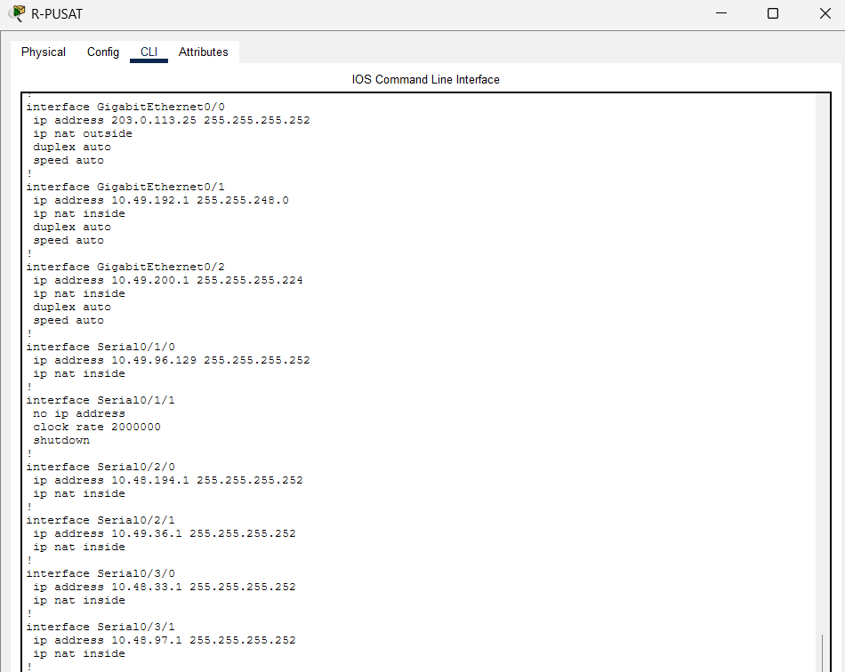

### Konfigurasi R-ISP

R-ISP hanya memiliki jaringan connected (8.8.8.0/24 dan 203.0.113.24/30). Tidak ada static route maupun routing dinamis ke jaringan 10.x.

```
configure terminal
no router rip
end
write memory
```

Paket balasan dari 8.8.8.8 tetap sampai karena tujuannya 203.0.113.25, yang berada pada jaringan connected R-ISP.

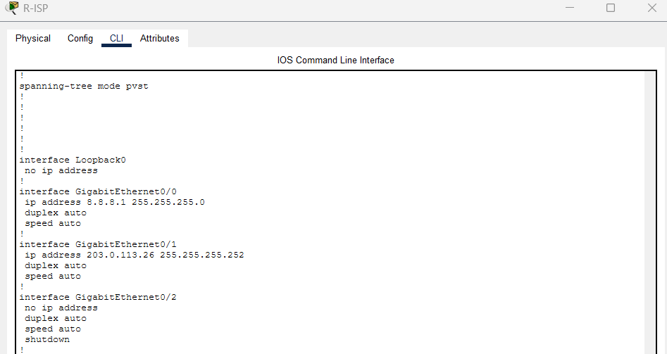
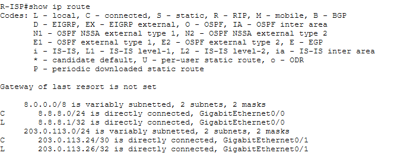

#### 2. Ping ke 8.8.8.8 dari seluruh host

1. PC-PEGAWAI-BALAIKOTA
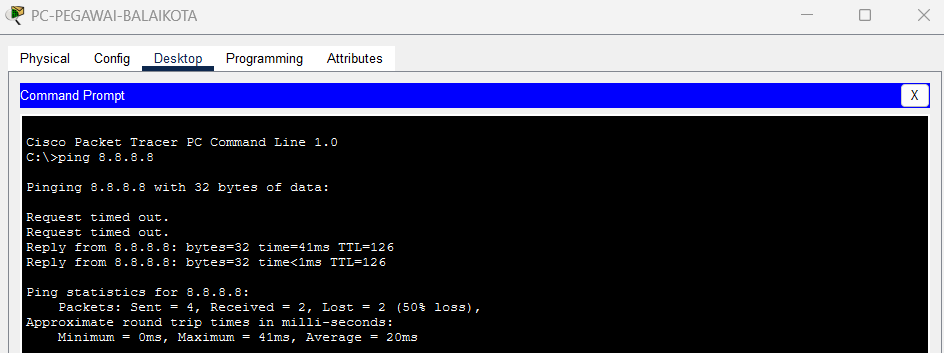

2. SRV-BALAIKOTA - 10.49.200.0/27
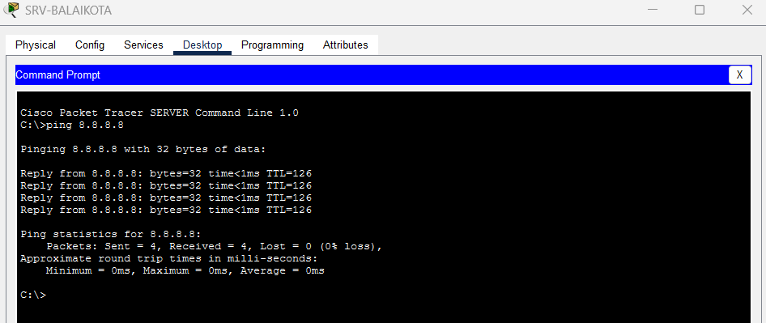

3. PC-CCTV-KOTA - 10.48.0.0/19 
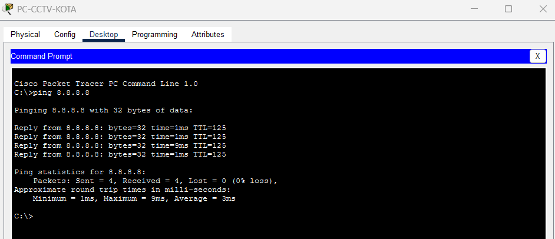

4. SRV-DC - 10.48.32.0/24
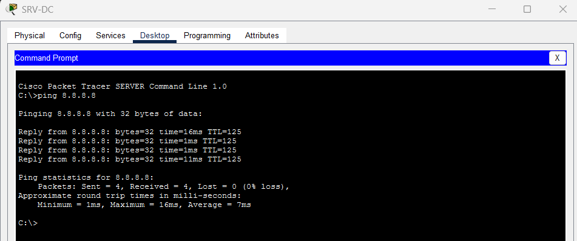

5. PC-PUSKESMAS-BARAT - 10.48.96.0/24
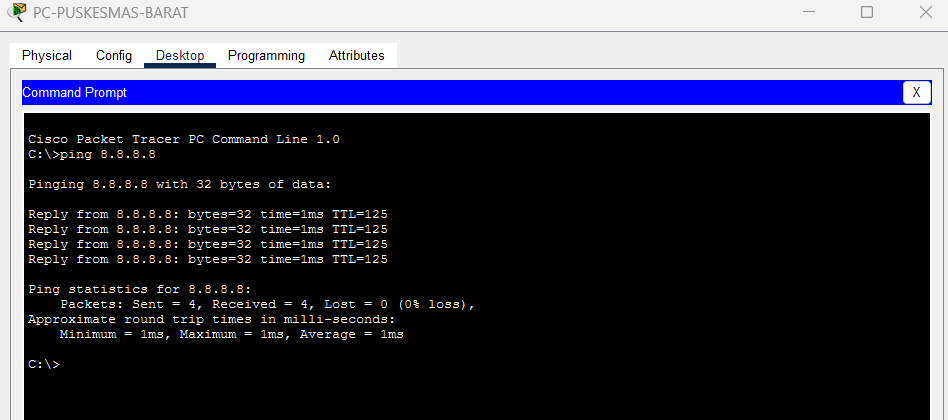

6. PC-SENSOR-LANTAS-UTARA - 10.48.192.0/23


7. PC-SENSOR-BANJIR-TIMUR - 10.49.32.0/22
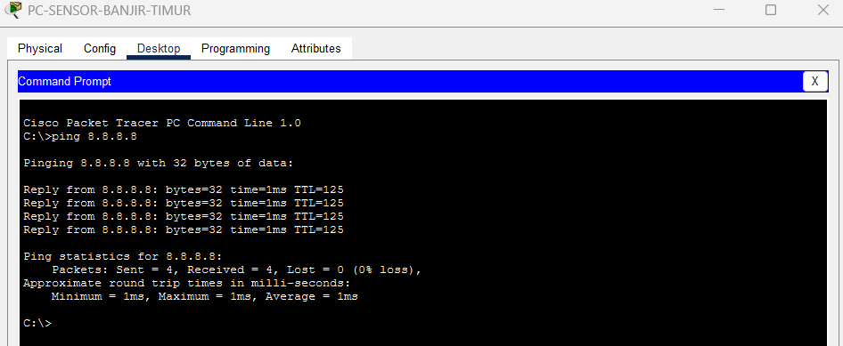

8. PC-PJU-SELATAN - 10.49.96.0/25
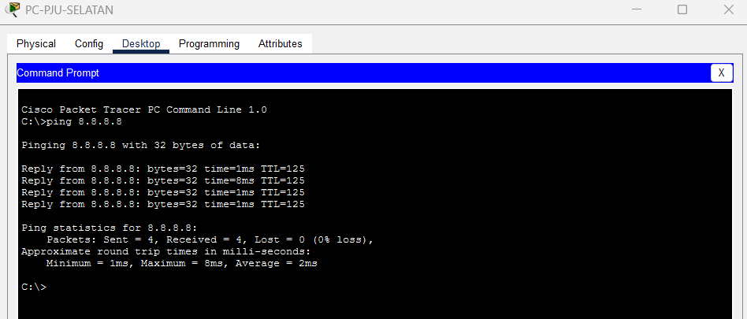

9. PC-SCADA-PELABUHAN - 10.49.128.0/19
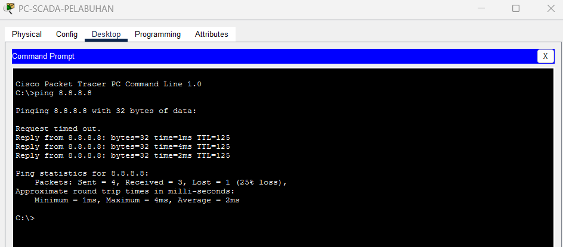

10. PC-KANTOR-PELABUHAN - 10.49.160.0/25
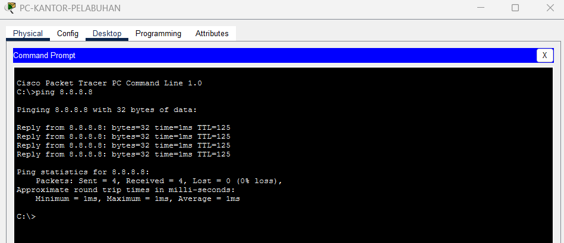

R-ISP tidak dapat melakukan ping ke jaringan internal:
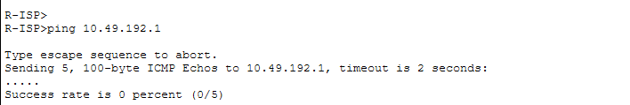

- Seluruh host dapat keluar karena static route (soal 3) membawa paket mereka ke R-PUSAT lewat default route, lalu R-PUSAT menerjemahkan alamat sumbernya.
- Paket ke 8.8.8.8 keluar dengan sumber 203.0.113.25, sehingga R-ISP tidak perlu mengetahui alamat privat sama sekali.

# Soal 6
```
6. Tunnel GRE (10)
. Bangun tunnel GRE antara R-PUSAT dan R-PELABUHAN.
. Lalu lintas antara subnet Balai Kota dan subnet Pelabuhan harus melewati tunnel.
· Jelaskan dalam dokumentasi mengapa router memilih jalur tunnel dibandingkan
jalur lain ke pelabuhan, dan mengapa GRE saja tidak mengenkripsi data.
. Bonus (+5): Buat lalu lintas di dalam tunnel terenkripsi dengan IPsec.
```

## 6. Tunnel GRE

### Ringkasan
Tunnel GRE antara R-PUSAT dan R-PELABUHAN (`192.168.6.0/30`) melewati R-UTARA. Trafik Balai Kota ke Pelabuhan dipaksa lewat tunnel dengan route yang lebih spesifik. Bonus: GRE dienkripsi dengan IPsec.

### Langkah
1. Pastikan R-PUSAT dan R-PELABUHAN saling ping lewat jalur biasa.
2. Buat tunnel.

**R-PUSAT**
```
interface Tunnel0
 ip address 192.168.6.1 255.255.255.252
 tunnel source Serial0/2/0
 tunnel destination 10.49.160.130
 tunnel mode gre ip
```
**R-PELABUHAN**
```
interface Tunnel0
 ip address 192.168.6.2 255.255.255.252
 tunnel source GigabitEthernet0/0
 tunnel destination 10.48.194.1
 tunnel mode gre ip
```
Di Packet Tracer, `tunnel source` harus berupa nama interface, bukan IP.

3. Route khusus lewat tunnel.

**R-PUSAT**
```
ip route 10.49.128.0 255.255.224.0 192.168.6.2
ip route 10.49.160.0 255.255.255.128 192.168.6.2
```
**R-PELABUHAN**
```
ip route 10.49.192.0 255.255.248.0 192.168.6.1
ip route 10.49.200.0 255.255.255.224 192.168.6.1
```

### Penjelasan
**Mengapa router memilih jalur tunnel:** router memakai aturan *longest prefix match*. Route lewat tunnel (/19 dan /25) lebih spesifik daripada route lewat R-UTARA (/18), sehingga dipilih lebih dulu.

**Mengapa GRE saja tidak mengenkripsi data:** GRE hanya *encapsulation*, yaitu membungkus paket asli dengan header IP baru. Isinya tetap plaintext dan tidak ada autentikasi, sehingga dapat dibaca siapa pun yang menyadap jalur. Kerahasiaan dan integritas hanya didapat dari protokol lain seperti IPsec.

**Catatan:** route tunnel di R-PUSAT berlaku untuk semua trafik menuju Pelabuhan, termasuk dari LAN selain Balai Kota. Pembatasan hanya untuk sumber Balai Kota akan membutuhkan policy-based routing.

### Bonus: GRE over IPsec (+5)
Prasyarat: lisensi `securityk9` aktif di kedua router (`license boot module c2900 technology-package securityk9`, lalu `write` dan `reload`).

**R-PUSAT**
```
crypto isakmp policy 10
 encryption aes
 hash sha
 authentication pre-share
 group 2
crypto isakmp key RAHASIA6 address 10.49.160.130
crypto ipsec transform-set TS-GRE esp-aes esp-sha-hmac
access-list 106 permit gre host 10.48.194.1 host 10.49.160.130
crypto map CM-GRE 10 ipsec-isakmp
 set peer 10.49.160.130
 set transform-set TS-GRE
 match address 106
interface Serial0/2/0
 crypto map CM-GRE
```
**R-PELABUHAN** dikonfigurasi sebagai cermin (peer `10.48.194.1`, ACL source dan destination dibalik, crypto map di `GigabitEthernet0/0`).

Packet Tracer tidak menyediakan `mode transport`, sehingga IPsec berjalan di mode tunnel (default). Hasil enkripsinya sama, hanya ada header IP tambahan.

### Pengujian
- `show ip interface brief`: Tunnel0 up/up di kedua router, dan `ping 192.168.6.2` dari R-PUSAT.
- `tracert` dari PC-PEGAWAI ke PC-SCADA-PELABUHAN: hop 10.49.192.1, 192.168.6.2, lalu tujuan (R-UTARA tidak terlihat).
- `tracert` dari PC-CCTV-KOTA ke SCADA: masih lewat R-UTARA.
- IPsec: `show crypto isakmp sa` (QM_IDLE) dan `show crypto ipsec sa` (counter encrypt/decrypt naik).
- Simulation mode: paket antara R-PUSAT dan R-PELABUHAN tampil sebagai ESP.

### Gambar
- 
- 
- 
- 
- 
- 
- 
- 
- 

---

# Soal 7
```
Dynamic routing OSPF (10). Kerjakan di file terpisah (copy file utama).
Tambahkan link baru (cadangan) L7 antara R-DC dan R-UTARA. Berikan alamat yang belum digunakan.
Ganti seluruh static route antar-router dengan OSPF. Ketentuannya:
Router tidak mengirim pesan OSPF ke arah LAN pengguna.
Default route ke internet hanya dikonfigurasi di R-PUSAT, dan router lain mendapatkannya secara otomatis melalui OSPF.
Jika salah satu link backbone putus, konektivitas harus pulih secara otomatis melalui jalur lain.
```
Tujuannya adalah mengganti seluruh static route antar-router dengan OSPF.

### Link Baru L7 (Cadangan)

| Link | Router A | Interface A | IP A | Router B | Interface B | IP B | Network |
|---|---|---|---|---|---|---|---|
| L7 | R-DC | Se0/3/1 | 10.49.208.1 | R-UTARA | Se0/3/1 | 10.49.208.2 | 10.49.208.0/30 |

Network 10.49.208.0/30 dipilih karena berada di luar seluruh blok yang sudah dialokasikan (LAN, link L1 sampai L6, dan link ISP), dan prefix /30 cukup untuk 2 host.

### Rancangan OSPF

| Router | Router ID | Interface non-passive (kirim hello) | Keterangan |
|---|---|---|---|
| R-PUSAT | 1.1.1.1 | Se0/1/0, Se0/2/0, Se0/2/1, Se0/3/0, Se0/3/1 | Satu-satunya yang `default-information originate` |
| R-DC | 2.2.2.2 | Se0/3/0, Se0/3/1 | Ke R-PUSAT (L1) dan R-UTARA (L7) |
| R-BARAT | 3.3.3.3 | Se0/3/0 | Ke R-PUSAT (L2) |
| R-TIMUR | 4.4.4.4 | Se0/3/0 | Ke R-PUSAT (L3) |
| R-SELATAN | 5.5.5.5 | Se0/3/0 | Ke R-PUSAT (L4) |
| R-UTARA | 6.6.6.6 | Se0/3/0, Se0/3/1, Gi0/2 | Ke R-PUSAT (L5), R-DC (L7), R-PELABUHAN (L6) |
| R-PELABUHAN | 7.7.7.7 | Gi0/0 | Ke R-UTARA (L6) |

- Semua router berada di area 0 dengan `network 10.48.0.0 0.1.255.255 area 0`, yang mencakup seluruh LAN dan link internal (10.48.0.0 sampai 10.49.255.255).
- Pesan OSPF tidak keluar ke LAN pengguna karena `passive-interface default` dipakai di semua router, lalu hanya interface menuju router lain yang dibuka dengan `no passive-interface`. Interface passive tetap diiklankan ke tetangga, tetapi tidak mengirim hello.

### Konfigurasi

#### Menghapus static route terlebih dahulu

- R-PUSAT (default route ke R-ISP tetap dipertahankan):

```
configure terminal
no ip route 10.48.0.0 255.255.224.0 10.48.33.2
no ip route 10.48.32.0 255.255.255.0 10.48.33.2
no ip route 10.48.64.0 255.255.224.0 10.48.97.2
no ip route 10.48.96.0 255.255.255.0 10.48.97.2
no ip route 10.49.0.0 255.255.224.0 10.49.36.2
no ip route 10.49.32.0 255.255.252.0 10.49.36.2
no ip route 10.49.64.0 255.255.224.0 10.49.96.130
no ip route 10.49.96.0 255.255.255.128 10.49.96.130
no ip route 10.48.128.0 255.255.192.0 10.48.194.2
no ip route 10.48.192.0 255.255.254.0 10.48.194.2
no ip route 10.49.128.0 255.255.224.0 10.48.194.2
no ip route 10.49.160.0 255.255.255.128 10.48.194.2
no ip route 10.49.160.128 255.255.255.252 10.48.194.2
end
```

- R-UTARA:

```
configure terminal
no ip route 0.0.0.0 0.0.0.0 10.48.194.1
no ip route 10.49.128.0 255.255.224.0 10.49.160.130
no ip route 10.49.160.0 255.255.255.128 10.49.160.130
end
```

Default route statis pada router lain dihapus dengan cara yang sama:

| Router | Command |
|---|---|
| R-DC | `no ip route 0.0.0.0 0.0.0.0 10.48.33.1` |
| R-BARAT | `no ip route 0.0.0.0 0.0.0.0 10.48.97.1` |
| R-TIMUR | `no ip route 0.0.0.0 0.0.0.0 10.49.36.1` |
| R-SELATAN | `no ip route 0.0.0.0 0.0.0.0 10.49.96.129` |
| R-PELABUHAN | `no ip route 0.0.0.0 0.0.0.0 10.49.160.129` |

#### Link L7

- R-DC:

```
configure terminal
interface Serial0/3/1
ip address 10.49.208.1 255.255.255.252
ip ospf cost 1000
no shutdown
end
```

- R-UTARA:

```
configure terminal
interface Serial0/3/1
ip address 10.49.208.2 255.255.255.252
ip ospf cost 1000
no shutdown
end
```
Cost 1000 dibuat jauh lebih besar dari jalur utama supaya L7 hanya dipakai saat ada link yang putus. Tanpa pengaturan cost, jalur langsung DC ke UTARA (1 hop) akan menang atas jalur lewat R-PUSAT (2 hop), sehingga L7 menjadi jalur utama, bukan cadangan. Pada sisi DCE kabel serial, clock rate juga ditambahkan.

#### R-PUSAT

```
configure terminal
router ospf 1
router-id 1.1.1.1
log-adjacency-changes
passive-interface default
no passive-interface Serial0/1/0
no passive-interface Serial0/2/0
no passive-interface Serial0/2/1
no passive-interface Serial0/3/0
no passive-interface Serial0/3/1
network 10.48.0.0 0.1.255.255 area 0
default-information originate
exit
ip route 0.0.0.0 0.0.0.0 203.0.113.26
end
write memory
```

#### R-DC

```
configure terminal
router ospf 1
router-id 2.2.2.2
log-adjacency-changes
passive-interface default
no passive-interface Serial0/3/0
no passive-interface Serial0/3/1
network 10.48.0.0 0.1.255.255 area 0
end
write memory
```

#### R-UTARA

```
configure terminal
router ospf 1
router-id 6.6.6.6
log-adjacency-changes
passive-interface default
no passive-interface Serial0/3/0
no passive-interface Serial0/3/1
no passive-interface GigabitEthernet0/2
network 10.48.0.0 0.1.255.255 area 0
end
write memory
```

#### R-BARAT, R-TIMUR, R-SELATAN

`router-id` dan `no passive-interface` diganti sesuai tabel, yaitu `Serial0/3/0`.

```
configure terminal
router ospf 1
router-id 3.3.3.3
log-adjacency-changes
passive-interface default
no passive-interface Serial0/3/0
network 10.48.0.0 0.1.255.255 area 0
end
write memory
```

Router ID: R-BARAT 3.3.3.3, R-TIMUR 4.4.4.4, R-SELATAN 5.5.5.5.

#### R-PELABUHAN

```
configure terminal
router ospf 1
router-id 7.7.7.7
log-adjacency-changes
passive-interface default
no passive-interface GigabitEthernet0/0
network 10.48.0.0 0.1.255.255 area 0
end
write memory
```

# Soal 8
```
8. Layanan aplikasi Smart City (10). Gunakan domain internal
k<nomor kelompok>.smartcity. lab.
a.DNS di LAN Server dan Storage DC. Nama www, ftp, dan mail dapat diakses dari
seluruh wilayah.

b.Web di LAN Server Balai Kota, berupa halaman "Portal Smart City Surabaya"
yang mencantumkan nomor kelompok dan dapat dibuka dengan nama domain
dari semua wilayah.

c.FTP di LAN Server dan Storage DC sebagai penyimpanan rekaman CCTV,
dengan akun login. Perangkat di LAN CCTV Kota dapat mengunggah file ke sana.

d.Email antarpegawai. Pengguna di Balai Kota dan Pelabuhan dapat saling
mengirim dan menerima email.
```

## 8. Layanan Aplikasi Smart City

### Ringkasan

| Layanan | Server | IP | Nama |
|---|---|---|---|
| DNS | SRV-DC | 10.48.32.2 | - |
| FTP | SRV-DC | 10.48.32.2 | ftp.k6.smartcity.lab |
| Web | SRV-BALAIKOTA | 10.49.200.2 | www.k6.smartcity.lab |
| Email | SRV-BALAIKOTA | 10.49.200.2 | mail.k6.smartcity.lab |

### a. DNS di LAN Server dan Storage DC
Services, DNS, On, tambahkan A Record: `www` dan `mail` ke 10.49.200.2, `ftp` ke 10.48.32.2. DNS Server `10.48.32.2` dibagikan lewat DHCP (bagian 4) dan diisi manual di server.

### b. Web di LAN Server Balai Kota
Services, HTTP, On, edit `index.html` menjadi halaman **"Portal Smart City Surabaya"** yang memuat tulisan **Kelompok 6**. Dibuka dengan `www.k6.smartcity.lab` dari seluruh wilayah.

### c. FTP di LAN Server dan Storage DC
Services, FTP, On, buat akun `cctv` (password `cctv123`) dengan permission Write, Read, Delete, Rename, dan List. Dari PC-CCTV-KOTA: `ftp ftp.k6.smartcity.lab`, login, lalu `put rekaman1.txt`.

### d. Email antarpegawai
Pada SRV-BALAIKOTA: Services, EMAIL, SMTP dan POP3 On, domain `k6.smartcity.lab`, user `pegawai` dan `pelabuhan`. Klien dikonfigurasi di Desktop, Email, Configure Mail:

| Kolom | PC-PEGAWAI-BALAIKOTA | PC-KANTOR-PELABUHAN |
|---|---|---|
| Email | pegawai@k6.smartcity.lab | pelabuhan@k6.smartcity.lab |
| Incoming / Outgoing | mail.k6.smartcity.lab | mail.k6.smartcity.lab |
| User / Password | pegawai / pegawai123 | pelabuhan / pelabuhan123 |

### Alasan
DNS dipusatkan di LAN Server DC dan dibagikan lewat DHCP, sehingga klien cukup memakai nama. Web dan email ditempatkan di LAN Server Balai Kota karena dekat pengguna utamanya. FTP di Server DC karena fungsinya penyimpanan rekaman CCTV, dengan akun login agar tidak sembarang perangkat dapat menulis. Trafik email antara Balai Kota dan Pelabuhan melewati tunnel GRE/IPsec dari soal 6.

### Pengujian
- `nslookup www.k6.smartcity.lab` dari PC di beberapa wilayah.
- Web Browser membuka `www.k6.smartcity.lab` dari minimal satu PC di tiap wilayah.
- FTP: `put` berhasil dan file terlihat dengan `dir`.
- Email dikirim dan diterima dua arah antara PC-PEGAWAI-BALAIKOTA dan PC-KANTOR-PELABUHAN.

### Gambar
- 
- 
- 
- 
- 
- 
- 
