## Mid Project Jarkom-K6

## Anggota Kelompok

| Nama                         | NRP        |
| ---------------------------- | ---------- |
| MADE GDE KRISNA WANGSA       | 5027201047 |
| Dea Chrisna Butarbutar | 5027251035 |
| Muhammad Faturrahman | 5027241065 |

# soal 1
```
1. Perancangan topologi (10)
# Bangun topologi di Cisco Packet Tracer sesuai skema yang kalian pilih (VLSM atau
CIDR).
  o Hubungan antar-router (backbone, link L1-L6), termasuk R-ISP dan server
8.8.8.8, wajib mengikuti Gambar 1.
  o Desain setiap lokasi silakan dirancang sendiri, mencakup susunan switch,
jenis perangkat yang dipasang (PC, perangkat mobile, atau server), media
link (kabel atau wireless), serta penambahan port pada router. Tuliskan
pertimbangan dan alasannya dalam dokumentasi.
  o Cukup pasang 1 perangkat perwakilan di setiap LAN. Perhitungan subnet
tetap menggunakan jumlah host penuh.
# Ganti nama bawaan setiap perangkat (misalnya RouterO, Switch1, PC2) dengan
nama yang menunjukkan tempatnya, seperti R-PUSAT, SW-BALAIKOTA, atau
PC-CCTV-KOTA.
# Tambahkan label di setiap LAN yang berisi nama subnet, Network ID/prefix, dan jumlah host.
```

## 1. Perancangan Topologi

### Ringkasan
Topologi berbentuk **hub-and-spoke berhierarki** dengan R-PUSAT (Balai Kota) sebagai pusat, mengikuti Gambar 1 soal. Terdapat 8 router, 14 LAN, dan 6 link backbone (L1 sampai L6).


### Langkah
1. Letakkan 8 router: R-ISP, R-PUSAT, R-DC, R-BARAT, R-UTARA, R-TIMUR, R-SELATAN, R-PELABUHAN.
2. Hubungkan backbone sesuai Gambar 1: R-PUSAT ke R-ISP, L1 (R-DC), L2 (R-UTARA), L3 (R-SELATAN), L4 (R-TIMUR), L5 (R-BARAT), serta L6 (R-UTARA ke R-PELABUHAN). Server 8.8.8.8 langsung ke R-ISP.
3. Pasang satu switch per LAN dan satu perangkat wakil per LAN. Wi-Fi Publik memakai Access Point dan smartphone.
4. Tambahkan port pada router yang kekurangan port (lihat tabel).
5. Ganti nama semua perangkat sesuai lokasinya, lalu tambahkan label LAN dan label link.

### Pertimbangan desain dan alasan

| Keputusan | Alasan |
|---|---|
| Hub-and-spoke dengan R-PUSAT sebagai pusat | Sesuai Gambar 1. Kontrol terpusat, troubleshooting mudah, gangguan satu link hanya memutus satu lokasi. Kekurangannya R-PUSAT menjadi single point of failure |
| R-ISP hanya terhubung ke R-PUSAT | Semua trafik internet lewat satu gerbang, sehingga NAT dan keamanan cukup di satu titik |
| R-PELABUHAN lewat R-UTARA (L6) | Pelabuhan berada di Surabaya Utara, jadi dihubungkan ke router terdekat |
| Satu switch per LAN | Tiap LAN adalah subnet dan broadcast domain terpisah, jadi tanpa VLAN. Lebih sederhana dan sesuai Gambar 1 |
| Kabel tembaga untuk LAN sensor, server, SCADA, dan kantor | Stabil, tidak terkena interferensi, cocok untuk layanan kritis |
| Wireless hanya untuk Wi-Fi Publik | Pengguna warga memakai perangkat mobile. AP tetap dikabel ke switch agar backhaul stabil |
| Port ditambah di R-PUSAT dan R-UTARA | Router 2911 hanya punya 3 port routed bawaan, sedangkan R-PUSAT butuh 8 dan R-UTARA butuh 4 |

### Perangkat

| Jenis | Model di Packet Tracer |
|---|---|
| Router | Cisco 2911 (R-PUSAT dan R-UTARA diperluas dengan modul/port tambahan) |
| Switch | Cisco 2960-24TT |
| Access Point | Access Point-PT |
| Perangkat pengguna | PC-PT, Smartphone-PT |
| Server | Server-PT |

### Daftar LAN dan perangkat wakil

| Router | LAN | Switch | Perangkat wakil |
|---|---|---|---|
| R-PUSAT | Pegawai Balai Kota | SW-PEGAWAI-BALAIKOTA | PC-PEGAWAI-BALAIKOTA |
| R-PUSAT | Server Balai Kota | SW-SERVER-BALAIKOTA | SRV-BALAIKOTA |
| R-DC | CCTV Kota | SW-CCTV | PC-CCTV-KOTA |
| R-DC | Server dan Storage DC | SW-SERVER-DC | SRV-DC |
| R-BARAT | WiFi Publik Barat | SW-WIFI-BARAT | AP-WIFI-BARAT, HP-WIFI-BARAT |
| R-BARAT | Puskesmas dan Sekolah Barat | SW-PUSKESMAS-BARAT | PC-PUSKESMAS-BARAT |
| R-UTARA | WiFi Publik Utara | SW-WIFI-UTARA | AP-WIFI-UTARA, HP-WIFI-UTARA |
| R-UTARA | Sensor Lalu Lintas Utara | SW-SENSOR-UTARA | PC-SENSOR-LANTAS-UTARA |
| R-TIMUR | WiFi Publik Timur | SW-WIFI-TIMUR | AP-WIFI-TIMUR, HP-WIFI-TIMUR |
| R-TIMUR | Sensor Banjir Timur | SW-BANJIR-TIMUR | PC-SENSOR-BANJIR-TIMUR |
| R-SELATAN | WiFi Publik Selatan | SW-WIFI-SELATAN | AP-WIFI-SELATAN, HP-WIFI-SELATAN |
| R-SELATAN | PJU Pintar Selatan | SW-PJU-SELATAN | PC-PJU-SELATAN |
| R-PELABUHAN | Sensor dan SCADA Pelabuhan | SW-SCADA-PELABUHAN | PC-SCADA-PELABUHAN |
| R-PELABUHAN | Kantor Pelabuhan | SW-KANTOR-PELABUHAN | PC-KANTOR-PELABUHAN |
| R-ISP | Server internet | (langsung) | Server 8.8.8.8 |

### Gambar
- 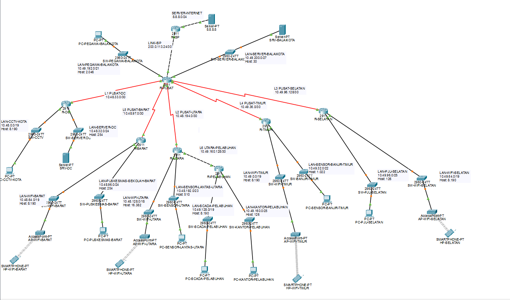
- 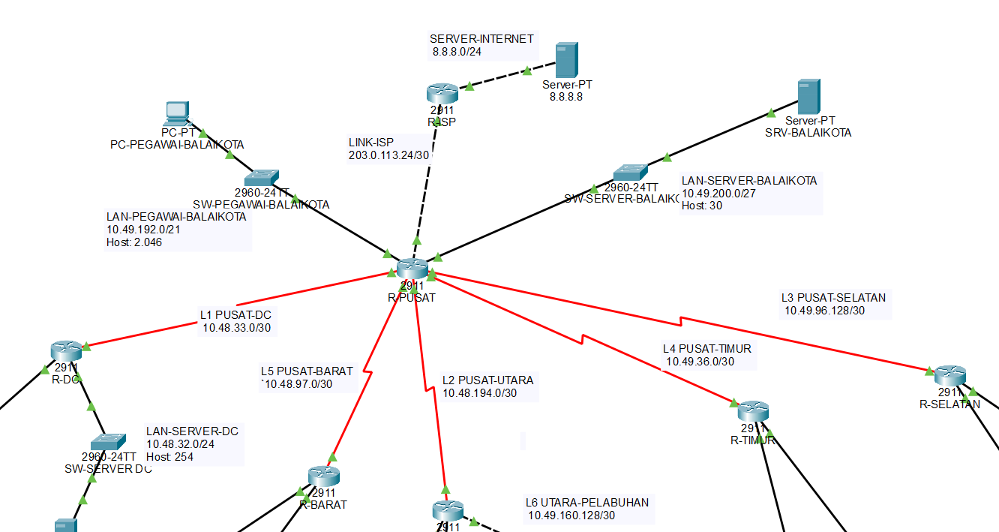 
- 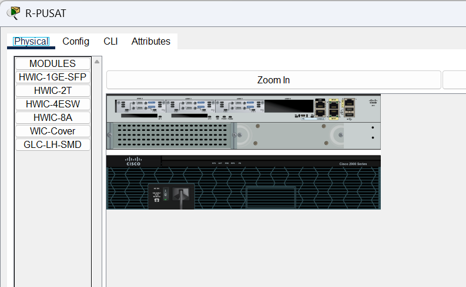
- 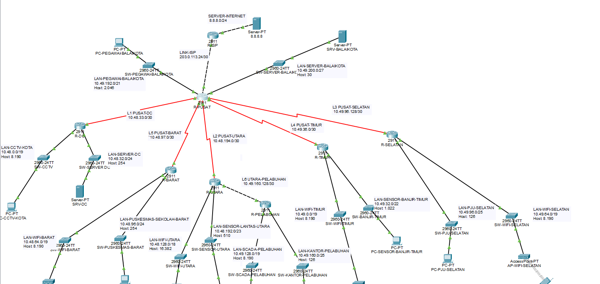
# soal 4
```
4. DHCP (10)
. Interface router dan seluruh server menggunakan IP statis.
. Perangkat pengguna mendapat IP dinamis secara otomatis, lengkap dengan
gateway dan DNS server (soal 8), tanpa bentrok dengan alamat IP statis.
. Khusus untuk subnet CCTV Kota (subnet R-DC) mendapatkan alamat dari server
DHCP di LAN Server dan Storage DC, bukan dari router.
```


## 4. DHCP

### Ringkasan
- Interface router dan semua server memakai **IP statis**.
- PC dan smartphone memakai **IP dinamis** lengkap dengan gateway dan DNS (`10.48.32.2`).
- Subnet CCTV Kota dilayani **DHCP di SRV-DC**, dengan relay `ip helper-address` di R-DC.
- Alamat awal tiap LAN (`.1` sampai `.10`) dikecualikan agar tidak bentrok dengan IP statis.

### Langkah
1. Isi IP statis server (lihat bagian 2).
2. **DHCP CCTV di SRV-DC:** Services, DHCP, On, dengan pool:

| Kolom | Isi |
|---|---|
| Pool Name | CCTV-KOTA |
| Default Gateway | 10.48.0.1 |
| DNS Server | 10.48.32.2 |
| Start IP | 10.48.0.10 |
| Subnet Mask | 255.255.224.0 |

3. **Relay di R-DC** (interface ke SW-CCTV, Gi0/1):
```
interface GigabitEthernet0/1
 ip helper-address 10.48.32.2
```
4. **DHCP di router** untuk 11 LAN pengguna (LAN CCTV dilayani SRV-DC, LAN server memakai IP statis sehingga tidak dibuatkan pool). Konfigurasi per router:

**R-PUSAT**
```
ip dhcp excluded-address 10.49.192.1 10.49.192.10
ip dhcp pool PEGAWAI-BALAIKOTA
 network 10.49.192.0 255.255.248.0
 default-router 10.49.192.1
 dns-server 10.48.32.2
```
 
**R-BARAT**
```
ip dhcp excluded-address 10.48.64.1 10.48.64.10
ip dhcp excluded-address 10.48.96.1 10.48.96.10
ip dhcp pool WIFI-BARAT
 network 10.48.64.0 255.255.224.0
 default-router 10.48.64.1
 dns-server 10.48.32.2
ip dhcp pool PUSKESMAS-BARAT
 network 10.48.96.0 255.255.255.0
 default-router 10.48.96.1
 dns-server 10.48.32.2
```
 
**R-UTARA**
```
ip dhcp excluded-address 10.48.128.1 10.48.128.10
ip dhcp excluded-address 10.48.192.1 10.48.192.10
ip dhcp pool WIFI-UTARA
 network 10.48.128.0 255.255.192.0
 default-router 10.48.128.1
 dns-server 10.48.32.2
ip dhcp pool SENSOR-LANTAS-UTARA
 network 10.48.192.0 255.255.254.0
 default-router 10.48.192.1
 dns-server 10.48.32.2
```
 
**R-TIMUR**
```
ip dhcp excluded-address 10.49.0.1 10.49.0.10
ip dhcp excluded-address 10.49.32.1 10.49.32.10
ip dhcp pool WIFI-TIMUR
 network 10.49.0.0 255.255.224.0
 default-router 10.49.0.1
 dns-server 10.48.32.2
ip dhcp pool SENSOR-BANJIR-TIMUR
 network 10.49.32.0 255.255.252.0
 default-router 10.49.32.1
 dns-server 10.48.32.2
```
 
**R-SELATAN**
```
ip dhcp excluded-address 10.49.64.1 10.49.64.10
ip dhcp excluded-address 10.49.96.1 10.49.96.10
ip dhcp pool WIFI-SELATAN
 network 10.49.64.0 255.255.224.0
 default-router 10.49.64.1
 dns-server 10.48.32.2
ip dhcp pool PJU-SELATAN
 network 10.49.96.0 255.255.255.128
 default-router 10.49.96.1
 dns-server 10.48.32.2
```
 
**R-PELABUHAN**
```
ip dhcp excluded-address 10.49.128.1 10.49.128.10
ip dhcp excluded-address 10.49.160.1 10.49.160.10
ip dhcp pool SCADA-PELABUHAN
 network 10.49.128.0 255.255.224.0
 default-router 10.49.128.1
 dns-server 10.48.32.2
ip dhcp pool KANTOR-PELABUHAN
 network 10.49.160.0 255.255.255.128
 default-router 10.49.160.1
 dns-server 10.48.32.2
```
 
**Ringkasan pool (dari tabel subnet UTS)**
 
| Router | Pool | Network ID | Mask (prefix) | Gateway |
|---|---|---|---|---|
| R-PUSAT | PEGAWAI-BALAIKOTA | 10.49.192.0 | 255.255.248.0 (/21) | 10.49.192.1 |
| R-BARAT | WIFI-BARAT | 10.48.64.0 | 255.255.224.0 (/19) | 10.48.64.1 |
| R-BARAT | PUSKESMAS-BARAT | 10.48.96.0 | 255.255.255.0 (/24) | 10.48.96.1 |
| R-UTARA | WIFI-UTARA | 10.48.128.0 | 255.255.192.0 (/18) | 10.48.128.1 |
| R-UTARA | SENSOR-LANTAS-UTARA | 10.48.192.0 | 255.255.254.0 (/23) | 10.48.192.1 |
| R-TIMUR | WIFI-TIMUR | 10.49.0.0 | 255.255.224.0 (/19) | 10.49.0.1 |
| R-TIMUR | SENSOR-BANJIR-TIMUR | 10.49.32.0 | 255.255.252.0 (/22) | 10.49.32.1 |
| R-SELATAN | WIFI-SELATAN | 10.49.64.0 | 255.255.224.0 (/19) | 10.49.64.1 |
| R-SELATAN | PJU-SELATAN | 10.49.96.0 | 255.255.255.128 (/25) | 10.49.96.1 |
| R-PELABUHAN | SCADA-PELABUHAN | 10.49.128.0 | 255.255.224.0 (/19) | 10.49.128.1 |
| R-PELABUHAN | KANTOR-PELABUHAN | 10.49.160.0 | 255.255.255.128 (/25) | 10.49.160.1 |
 
5. Ubah semua PC dan smartphone ke **DHCP**.

### Asal angka di konfigurasi
- `network` adalah Network ID, mask berasal dari prefix, dan `default-router` adalah Gateway dari tabel UTS.
- `excluded-address .1 sampai .10`: `.1` dipakai gateway, `.2` sampai `.10` cadangan alamat statis.

### Alasan
DHCP CCTV dipusatkan di server sesuai syarat soal, dan relay dipakai karena broadcast DHCP tidak melewati router. LAN lain memakai DHCP router karena sederhana dan tidak bergantung pada server lain.

### Pengujian
- `ipconfig` di PC: IP, mask, gateway, dan DNS sesuai LAN-nya.
- `show ip dhcp binding` di router, dan tab DHCP di SRV-DC untuk lease CCTV.

### Gambar
-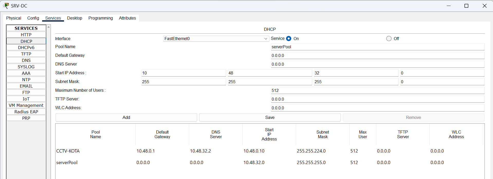
- 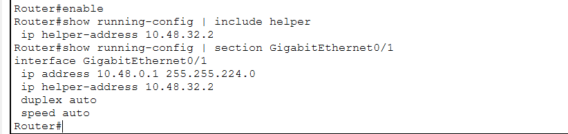
- 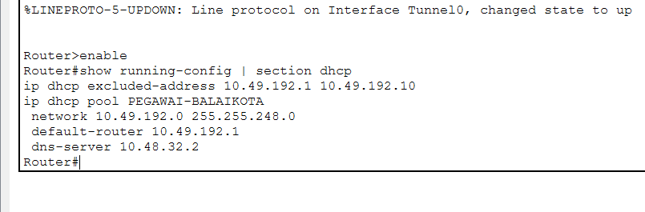
- 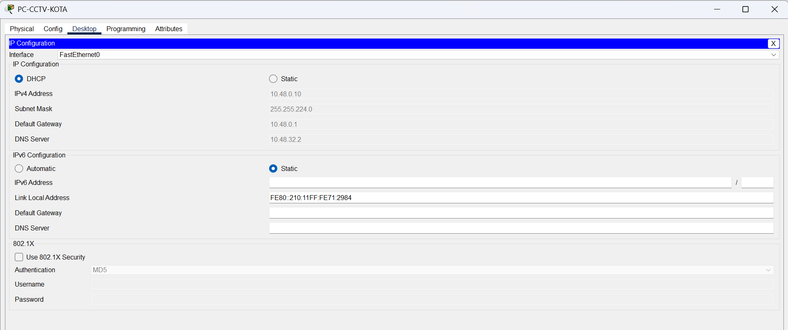
- 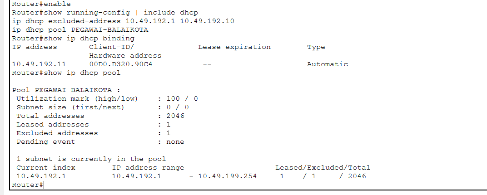

# Soal 6
```
6. Tunnel GRE (10)
. Bangun tunnel GRE antara R-PUSAT dan R-PELABUHAN.
. Lalu lintas antara subnet Balai Kota dan subnet Pelabuhan harus melewati tunnel.
· Jelaskan dalam dokumentasi mengapa router memilih jalur tunnel dibandingkan
jalur lain ke pelabuhan, dan mengapa GRE saja tidak mengenkripsi data.
. Bonus (+5): Buat lalu lintas di dalam tunnel terenkripsi dengan IPsec.
```

## 6. Tunnel GRE

### Ringkasan
Tunnel GRE antara R-PUSAT dan R-PELABUHAN (`192.168.6.0/30`) melewati R-UTARA. Trafik Balai Kota ke Pelabuhan dipaksa lewat tunnel dengan route yang lebih spesifik. Bonus: GRE dienkripsi dengan IPsec.

### Langkah
1. Pastikan R-PUSAT dan R-PELABUHAN saling ping lewat jalur biasa.
2. Buat tunnel.

**R-PUSAT**
```
interface Tunnel0
 ip address 192.168.6.1 255.255.255.252
 tunnel source Serial0/2/0
 tunnel destination 10.49.160.130
 tunnel mode gre ip
```
**R-PELABUHAN**
```
interface Tunnel0
 ip address 192.168.6.2 255.255.255.252
 tunnel source GigabitEthernet0/0
 tunnel destination 10.48.194.1
 tunnel mode gre ip
```
Di Packet Tracer, `tunnel source` harus berupa nama interface, bukan IP.

3. Route khusus lewat tunnel.

**R-PUSAT**
```
ip route 10.49.128.0 255.255.224.0 192.168.6.2
ip route 10.49.160.0 255.255.255.128 192.168.6.2
```
**R-PELABUHAN**
```
ip route 10.49.192.0 255.255.248.0 192.168.6.1
ip route 10.49.200.0 255.255.255.224 192.168.6.1
```

### Penjelasan
**Mengapa router memilih jalur tunnel:** router memakai aturan *longest prefix match*. Route lewat tunnel (/19 dan /25) lebih spesifik daripada route lewat R-UTARA (/18), sehingga dipilih lebih dulu.

**Mengapa GRE saja tidak mengenkripsi data:** GRE hanya *encapsulation*, yaitu membungkus paket asli dengan header IP baru. Isinya tetap plaintext dan tidak ada autentikasi, sehingga dapat dibaca siapa pun yang menyadap jalur. Kerahasiaan dan integritas hanya didapat dari protokol lain seperti IPsec.

**Catatan:** route tunnel di R-PUSAT berlaku untuk semua trafik menuju Pelabuhan, termasuk dari LAN selain Balai Kota. Pembatasan hanya untuk sumber Balai Kota akan membutuhkan policy-based routing.

### Bonus: GRE over IPsec (+5)
Prasyarat: lisensi `securityk9` aktif di kedua router (`license boot module c2900 technology-package securityk9`, lalu `write` dan `reload`).

**R-PUSAT**
```
crypto isakmp policy 10
 encryption aes
 hash sha
 authentication pre-share
 group 2
crypto isakmp key RAHASIA6 address 10.49.160.130
crypto ipsec transform-set TS-GRE esp-aes esp-sha-hmac
access-list 106 permit gre host 10.48.194.1 host 10.49.160.130
crypto map CM-GRE 10 ipsec-isakmp
 set peer 10.49.160.130
 set transform-set TS-GRE
 match address 106
interface Serial0/2/0
 crypto map CM-GRE
```
**R-PELABUHAN** dikonfigurasi sebagai cermin (peer `10.48.194.1`, ACL source dan destination dibalik, crypto map di `GigabitEthernet0/0`).

Packet Tracer tidak menyediakan `mode transport`, sehingga IPsec berjalan di mode tunnel (default). Hasil enkripsinya sama, hanya ada header IP tambahan.

### Pengujian
- `show ip interface brief`: Tunnel0 up/up di kedua router, dan `ping 192.168.6.2` dari R-PUSAT.
- `tracert` dari PC-PEGAWAI ke PC-SCADA-PELABUHAN: hop 10.49.192.1, 192.168.6.2, lalu tujuan (R-UTARA tidak terlihat).
- `tracert` dari PC-CCTV-KOTA ke SCADA: masih lewat R-UTARA.
- IPsec: `show crypto isakmp sa` (QM_IDLE) dan `show crypto ipsec sa` (counter encrypt/decrypt naik).
- Simulation mode: paket antara R-PUSAT dan R-PELABUHAN tampil sebagai ESP.

### Gambar
- 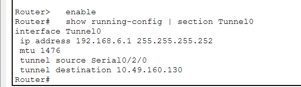
- 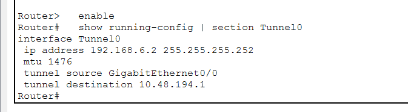
- 
- 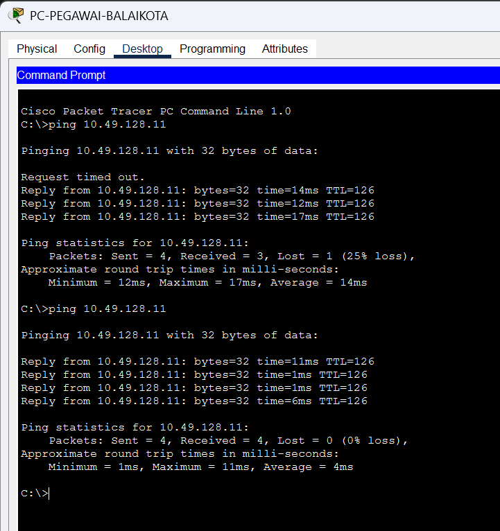
- 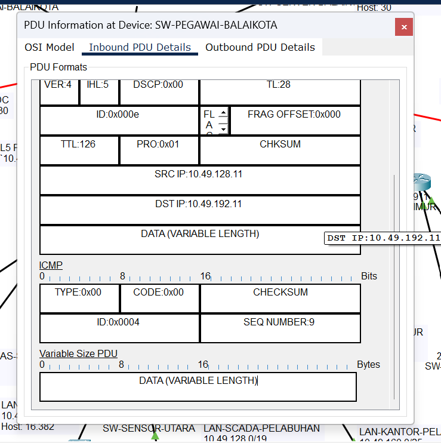
- 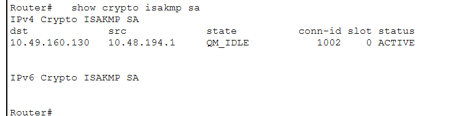
- 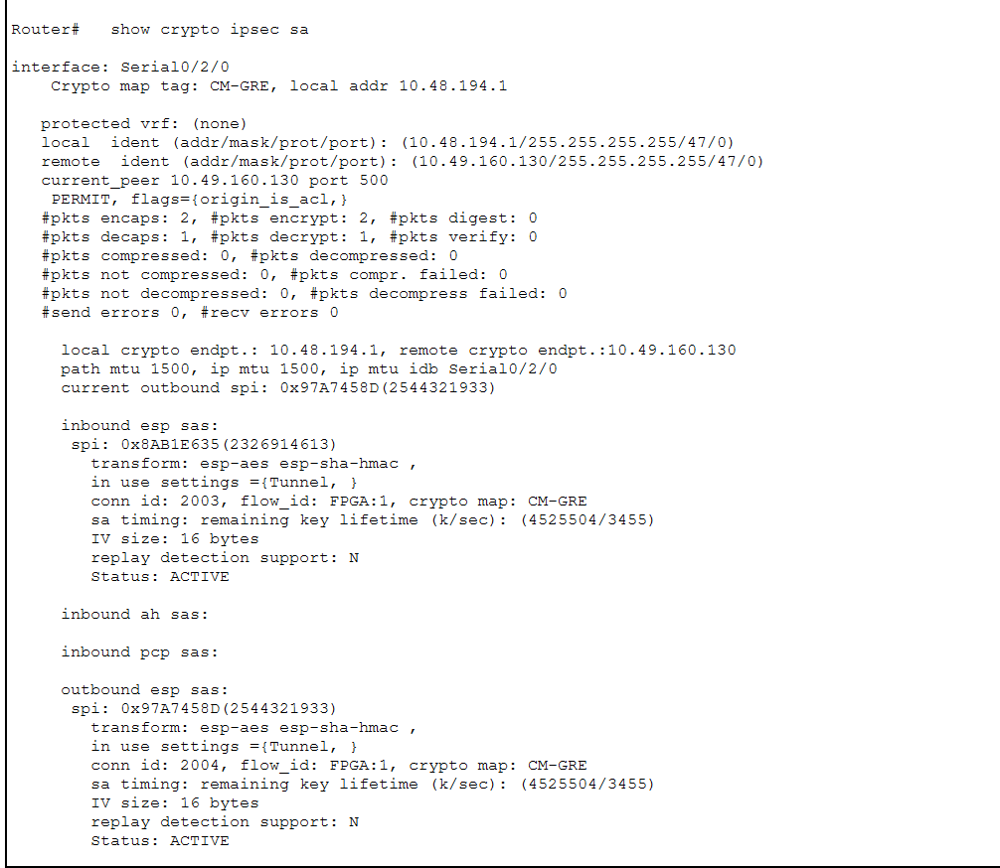
- 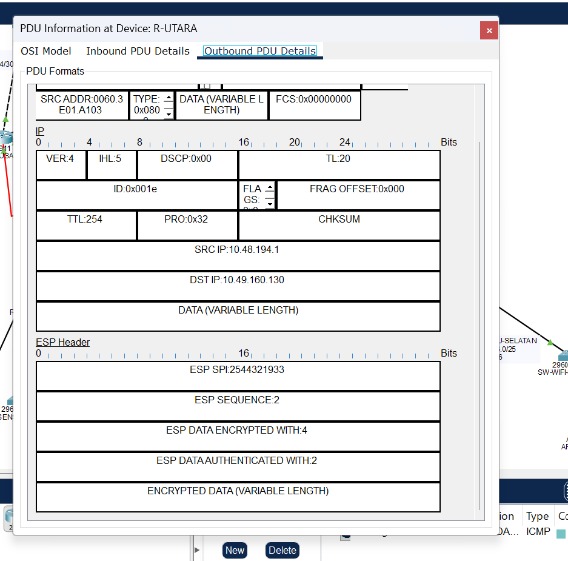
- 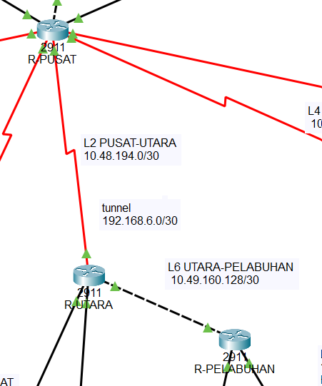

---

# Soal 8
```
8. Layanan aplikasi Smart City (10). Gunakan domain internal
k<nomor kelompok>.smartcity. lab.
a.DNS di LAN Server dan Storage DC. Nama www, ftp, dan mail dapat diakses dari
seluruh wilayah.

b.Web di LAN Server Balai Kota, berupa halaman "Portal Smart City Surabaya"
yang mencantumkan nomor kelompok dan dapat dibuka dengan nama domain
dari semua wilayah.

c.FTP di LAN Server dan Storage DC sebagai penyimpanan rekaman CCTV,
dengan akun login. Perangkat di LAN CCTV Kota dapat mengunggah file ke sana.

d.Email antarpegawai. Pengguna di Balai Kota dan Pelabuhan dapat saling
mengirim dan menerima email.
```

## 8. Layanan Aplikasi Smart City

### Ringkasan

| Layanan | Server | IP | Nama |
|---|---|---|---|
| DNS | SRV-DC | 10.48.32.2 | - |
| FTP | SRV-DC | 10.48.32.2 | ftp.k6.smartcity.lab |
| Web | SRV-BALAIKOTA | 10.49.200.2 | www.k6.smartcity.lab |
| Email | SRV-BALAIKOTA | 10.49.200.2 | mail.k6.smartcity.lab |

### a. DNS di LAN Server dan Storage DC
Services, DNS, On, tambahkan A Record: `www` dan `mail` ke 10.49.200.2, `ftp` ke 10.48.32.2. DNS Server `10.48.32.2` dibagikan lewat DHCP (bagian 4) dan diisi manual di server.

### b. Web di LAN Server Balai Kota
Services, HTTP, On, edit `index.html` menjadi halaman **"Portal Smart City Surabaya"** yang memuat tulisan **Kelompok 6**. Dibuka dengan `www.k6.smartcity.lab` dari seluruh wilayah.

### c. FTP di LAN Server dan Storage DC
Services, FTP, On, buat akun `cctv` (password `cctv123`) dengan permission Write, Read, Delete, Rename, dan List. Dari PC-CCTV-KOTA: `ftp ftp.k6.smartcity.lab`, login, lalu `put rekaman1.txt`.

### d. Email antarpegawai
Pada SRV-BALAIKOTA: Services, EMAIL, SMTP dan POP3 On, domain `k6.smartcity.lab`, user `pegawai` dan `pelabuhan`. Klien dikonfigurasi di Desktop, Email, Configure Mail:

| Kolom | PC-PEGAWAI-BALAIKOTA | PC-KANTOR-PELABUHAN |
|---|---|---|
| Email | pegawai@k6.smartcity.lab | pelabuhan@k6.smartcity.lab |
| Incoming / Outgoing | mail.k6.smartcity.lab | mail.k6.smartcity.lab |
| User / Password | pegawai / pegawai123 | pelabuhan / pelabuhan123 |

### Alasan
DNS dipusatkan di LAN Server DC dan dibagikan lewat DHCP, sehingga klien cukup memakai nama. Web dan email ditempatkan di LAN Server Balai Kota karena dekat pengguna utamanya. FTP di Server DC karena fungsinya penyimpanan rekaman CCTV, dengan akun login agar tidak sembarang perangkat dapat menulis. Trafik email antara Balai Kota dan Pelabuhan melewati tunnel GRE/IPsec dari soal 6.

### Pengujian
- `nslookup www.k6.smartcity.lab` dari PC di beberapa wilayah.
- Web Browser membuka `www.k6.smartcity.lab` dari minimal satu PC di tiap wilayah.
- FTP: `put` berhasil dan file terlihat dengan `dir`.
- Email dikirim dan diterima dua arah antara PC-PEGAWAI-BALAIKOTA dan PC-KANTOR-PELABUHAN.

### Gambar
- 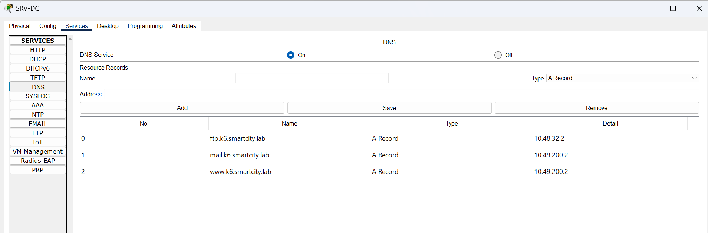
- 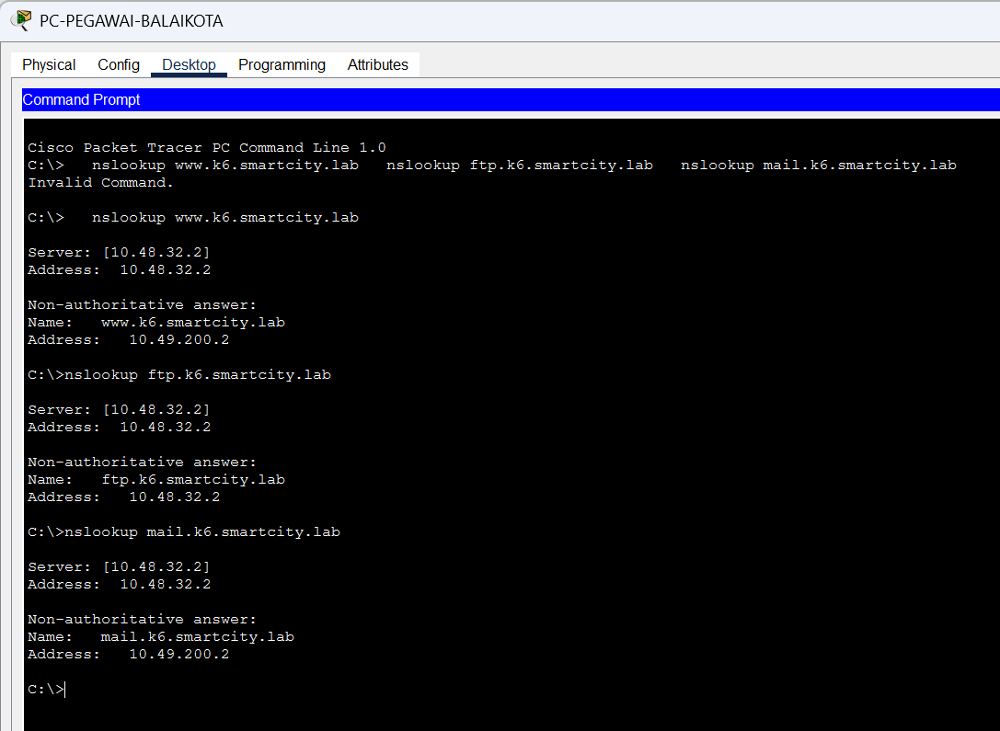
- 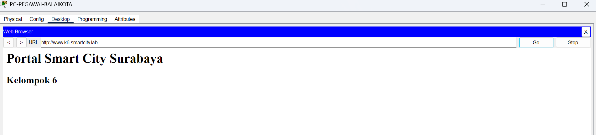
- 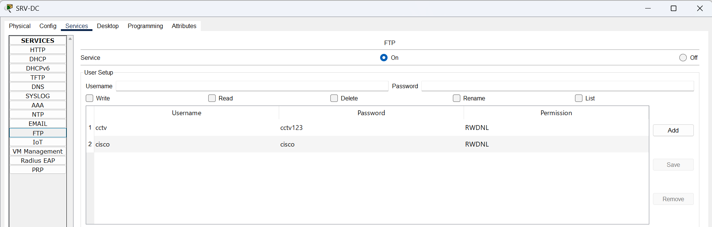
- 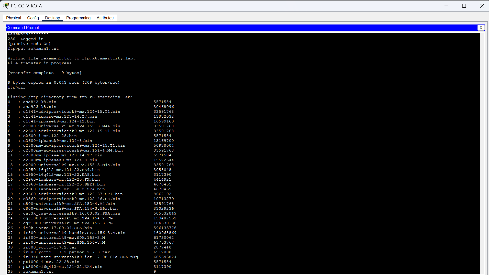
- 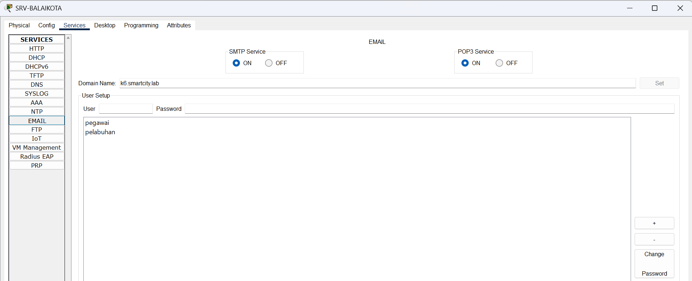
- 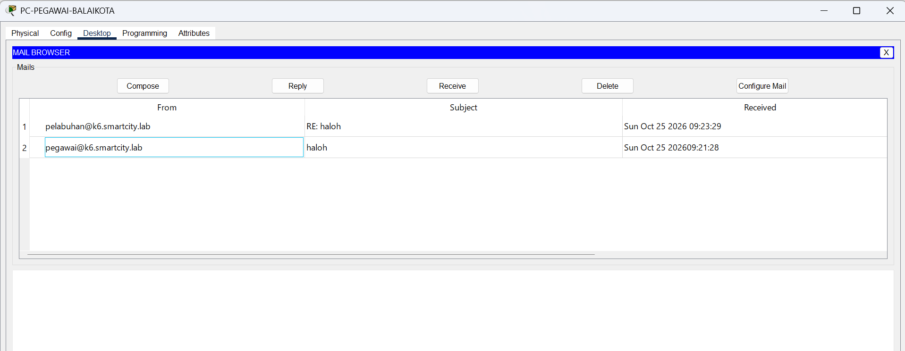
